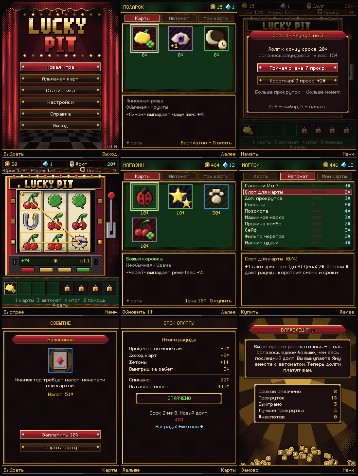

# Lucky Pit — «Яма удачи»

Roguelike-игра про игровой автомат для кнопочных телефонов Nokia Series 40
(цель — **Nokia 301**, экран 240×320). Java ME: **CLDC 1.1 + MIDP 2.0**.



> Игра работает **только на виртуальных монетах**. В ней нет реальных ставок,
> платежей, вывода денег, рекламы и сетевых функций. Интернет не нужен.

## Что внутри

- **Автомат 3×3** с последовательной остановкой барабанов, отскоком,
  размытием на скорости, рычагом, бегущими лампами и бликом стекла.
  Результат прокрутки целиком рассчитывается **до анимации**
  (`SlotMachine.spin`). Барабаны только показывают готовый результат:
  символы, которые проносятся мимо, берутся из отдельного «визуального»
  генератора и на выигрыш не влияют. Эффекты карт, меняющие поле
  («Машина хаоса», «Джокер», «Эхо»…), показываются отдельными шагами со
  вспышкой карты.
- **10 символов**: вишня, лимон, подкова, колокол, клевер, звезда, алмаз,
  семёрка, «Око» (дикий символ) и «Череп» (три черепа в линию сжигают
  выигрыш).
- **10 линий**: 3 горизонтали и 2 диагонали активны с начала, V-линии и
  колонны покупаются. Есть комбо за несколько линий, россыпь звёзд и
  джекпот ×10 (все 9 символов одинаковые).
- **188 уникальных карт** шести редкостей (обычная, необычная, редкая,
  эпическая, легендарная, проклятая). У каждой своё название, своя
  пиксельная иллюстрация 24×24 (в магазине — 48×48 через целочисленное
  ×2) и реальный эффект — всего 61 тип эффекта. Описания генерируются из
  тех же параметров, которые читает игровой код, поэтому текст карты не
  может разойтись с механикой.
- **Синергии**: 8 семей карт с бонусами при 2 и 4 картах, «Зеркало» (копирует
  карту справа — порядок карт важен), бонусы за число карт, за редкость, за
  проклятые карты, за разнообразие семей, растущие карты со счётчиками.
- **Рогалик**: 8 сроков по 3 раунда, растущий долг, выбор смены перед раундом
  (полная или короткая с жетонами), досрочное погашение, проценты, магазин
  между раундами (покупка, продажа, обновление витрины, перестановка карт),
  10 улучшений автомата за жетоны, 12 случайных событий с выбором,
  стартовый подарок, **3 победные концовки** («Свобода», «Владелец Ямы»,
  «Проклятый хозяин») и поражение.
- **Статистика**, **альманах** открытых карт, **настройки** (звук, музыка,
  эффекты, скорость барабанов, сброс прогресса), справка из 7 страниц.
- **Звук**: 13 эффектов (WAV 8 кГц, 8 бит, моно) и MIDI-луп для меню и
  магазина. Поддержка форматов проверяется на устройстве через
  `Manager.getSupportedContentTypes`. Если WAV не поддерживается, вместо него
  звучат тоны `Manager.playTone`. Если устройство не умеет смешивать звуки
  (`supports.mixing`), эффекты не перебивают музыку.
- **Сохранения в RMS**: монеты, жетоны, долг, срок и раунд, оставшиеся
  прокрутки, карты (со счётчиками и ценой покупки), улучшения, события,
  витрина магазина, состояние генератора случайных чисел, последнее поле,
  статистика, альманах и настройки.

## Управление

| Клавиша | Действие |
|---|---|
| 2 / 8 / 4 / 6 (или джойстик) | вверх / вниз / влево / вправо |
| 5 (центр джойстика) | прокрутка / выбор / купить |
| 1 | ваши карты |
| 3 | об автомате (выплаты, шансы, линии, модификаторы) |
| 7 | магазин (после раунда); на автомате — подсказка |
| 9 | статистика |
| 0 | справка |
| * | подробности: разбор прокрутки, бонусы семей |
| # | переключение вкладок / сеты |
| Левая софт-клавиша | действие экрана (крутить, начать, купить, продать, обновить) |
| Правая софт-клавиша | назад / меню / пауза |

Сенсорный экран не нужен. Во время прокрутки 5 останавливает барабаны быстрее.

## Установка на Nokia 301

Готовые файлы лежат в `dist/`: **`LuckyPit.jar`** и **`LuckyPit.jad`**.

1. Подключите телефон кабелем micro-USB в режиме «Накопитель» (Mass storage)
   или передайте файлы по Bluetooth.
2. Скопируйте `LuckyPit.jar` (и при желании `LuckyPit.jad`) на карту памяти
   или в память телефона, например в папку `Others` или `Downloads`.
3. На телефоне откройте **Файлы**, найдите `LuckyPit.jar` и запустите его.
   Подтвердите установку. Игра появится в **Приложения → Мои приложения**
   (на S40 — «Коллекция»).
4. Если телефон спросит, разрешать ли приложению «чтение/запись данных», ответьте
   «Да» или «Спрашивать один раз». Игра пишет только в собственное хранилище
   RMS и не запрашивает ни сеть, ни файлы.

Если устанавливаете через `.jad`, положите `.jad` и `.jar` в одну папку и
откройте `.jad`. В `MIDlet-Jar-Size` записан точный размер JAR, и build.sh
пересчитывает его при каждой сборке.

## Сборка

Нужны: JDK 8 или новее (проверено на OpenJDK 21), `curl`, `jar`, Python 3
(для проверки классов). Для пересборки графики и звука нужен ещё Pillow.

```sh
cd LuckyPit
./build.sh            # компиляция + упаковка, результат в dist/
./build.sh --assets   # заново сгенерировать все PNG/WAV/MIDI/карты (Python 3 + Pillow)
./build.sh --debug    # отладочная сборка в dist/debug/ (лог в консоль, тестовые читы)
```

Что делает `build.sh`:

1. Скачивает из Maven Central заглушки API `cldcapi11` и `midpapi20`
   (проект MicroEmulator) и компилятор Eclipse `ecj-4.6.1`.
2. Компилирует с `-source 1.3 -target cldc1.1 -bootclasspath cldc+midp`.
   Таргет `cldc1.1` в ECJ сразу пишет атрибуты **StackMap**, то есть
   выполняет preverification по требованиям CLDC. Отдельный `preverify`
   из WTK не нужен. bootclasspath содержит только CLDC 1.1 и MIDP 2.0,
   поэтому использовать API вне этих профилей невозможно: сборка просто
   не пройдёт.
3. Пакует JAR с MIDlet-манифестом и пишет JAD с точным `MIDlet-Jar-Size`.
4. Запускает `tools/verify_classes.py`: версия class-файлов ≤ 48, нет
   `StackMapTable` (формат Java 6), есть StackMap, все внешние классы
   найдены в CLDC 1.1 / MIDP 2.0.

## Структура проекта

```
LuckyPit/
  build.sh                 сборка JAR/JAD
  dist/                    готовые LuckyPit.jar и LuckyPit.jad
  res/                     ресурсы, попадающие в JAR
    sym.png, symb.png      символы барабанов 36×36 и их размытая версия
    c/0..187.png           иллюстрации карт 24×24
    cards.dat              таблица карт (эффекты, названия, описания)
    font.png, font.bin     пиксельный шрифт (латиница, кириллица, значки)
    bg_*.png               фоны: меню, автомат, комната, магазин, победа, поражение
    *.png                  рамки, кнопки, лампы, рычаг, иконки, курсор, блик
    s_*.wav, m_lounge.mid  звуковые эффекты и музыка
  src/luckypit/            исходный код (CLDC 1.1 / MIDP 2.0, синтаксис Java 1.3)
  tools/                   генераторы ресурсов на Python и проверка классов
  test/                    симулятор баланса, драйвер эмулятора, профиль 240×320
```

Классы игры:

| Класс | Назначение |
|---|---|
| `LuckyPitMIDlet` | жизненный цикл MIDlet (старт, пауза при звонке, выход) |
| `GameCanvas` | полноэкранный `GameCanvas`, игровой цикл ~25 FPS, очередь клавиш |
| `MenuManager` | экраны, переходы-шторки, маршрутизация по фазе забега |
| `GameState` | всё состояние забега и его сериализация |
| `SlotMachine` | веса, бросок поля, эффекты, линии, множители, выплаты |
| `Reel` | анимация одного барабана |
| `Symbol` | символы, ценности, веса |
| `Card`, `CardManager` | база карт, владение, слоты, предложения магазина |
| `EffectManager` | эффекты карт, сеты семей, улучшения → снимок модификаторов |
| `Shop` | витрина, покупка, продажа, улучшения |
| `DebtManager` | долги, раунды, проценты, сроки, концовки |
| `EventManager` | случайные события |
| `SaveManager` | RMS, CRC32, два чередующихся слота, фоновая запись |
| `ResourceManager` | загрузка и кэши изображений, масштаб ×2 |
| `SoundManager` | MMAPI в отдельном потоке, проверка форматов, запасные тоны |
| `PixelFont`, `Gfx`, `Fx` | шрифт, отрисовка интерфейса, частицы и вспышки |
| `*Screen` | экраны: меню, автомат, итоги раунда, событие, магазин, карты и др. |

## Оптимизация под Series 40

- Цикл на одном потоке, фиксированный шаг 40 мс (~25 FPS), пропуск кадров при
  нехватке времени. Шрифт перекрашивается один раз при старте; текст рисуется
  через `drawRegion` по глифам, числа — без создания строк.
- Частицы, надписи и результаты прокрутки лежат в пулах и массивах фиксированного
  размера, в игровом цикле не выделяется память.
- В памяти держится только один полноэкранный фон. Иллюстрации карт хранятся в
  LRU-кэше (24 штуки и 8 увеличенных). Расчёт памяти под изображения при
  32 бит/пиксель: шрифты ~352 КБ, спрайты ~250 КБ, фон 300 КБ, буфер
  `GameCanvas` 300 КБ, кэш карт ~130 КБ. Пик — около 1,4 МБ.
- Создание `Player` вынесено в фоновый поток. Плееров не больше четырёх,
  лишние освобождаются.
- Сохранение: состояние сериализуется в игровом потоке, а в RMS пишется в
  фоне. При выходе и сворачивании запись выполняется синхронно.
- Запись в RMS атомарна: у каждого блока CRC32 и порядковый номер, и
  при порче последнего блока загружается предыдущий.
- Вещественные числа не используются вообще: все проценты, множители и
  анимации считаются в целых числах с фиксированной точкой.
- Звонок или сворачивание (`hideNotify`/`pauseApp`) ставят игру на паузу:
  анимация прокрутки досрочно завершается (результат уже сохранён),
  прогресс записывается, звук останавливается, при возврате открывается меню
  паузы.

## Баланс

`test/run_tests.sh` прогоняет настоящие игровые классы на Java SE: тест
целостности сохранений (`SaveTest`) и симулятор баланса с ботами (`Sim`):

| Бот | Побед |
|---|---|
| пассивный (ничего не покупает) | 0% |
| случайные покупки | ~1–2% |
| жадный (тратит всё) | ~4% |
| осторожный эвристический | ~2% |
| оценка карт Монте-Карло (бот 4) | **~60%** |

Удача решает мало: выигрывает тот, кто считает. Подробнее — в
`docs/TESTING.md`.

## Что проверено и что нет

Подробности — в `docs/TESTING.md`. Коротко:

- ✅ Проект собирается скриптом, классы проходят проверку (CLDC 1.1, MIDP 2.0,
  StackMap). JAD соответствует JAR.
- ✅ Игра запущена в **MicroEmulator 2.0.4** с экраном 240×320 и
  клавишами Nokia (софт-клавиши −6/−7) под Xvfb. Нажатия посылались через
  `java.awt.Robot`. Пройдены: меню, подарок, раунды, выигрыши, магазин,
  все вкладки, карты, информация, пауза, конец раунда, оплата срока,
  поражение, победа, продолжение после перезапуска.
- ⚠️ **На настоящей Nokia 301 игра не запускалась** — устройства не было.
  Совместимость с ней не подтверждена. Звук в контейнере проверить
  нельзя (нет аудиоустройства): код проверяет поддержку форматов и
  молча переключается на тоны или тишину. Реальную частоту кадров и
  потребление памяти на Nokia 301 нужно замерить на устройстве (в отладочной
  сборке FPS и свободная память пишутся в консоль, а свободная память видна в
  «Настройках»).
- ⚠️ Характеристики Nokia 301 (Series 40 6th Edition FP1, Java Runtime 1.0.0,
  куча около 4 МБ, JAR до 2 МБ) взяты из вторичного источника
  (Legacy Portable Computing Wiki); официальной документации Nokia найти не
  удалось. Поэтому игра рассчитана с запасом: JAR около 0,3 МБ, пик памяти
  около 1,4 МБ.
