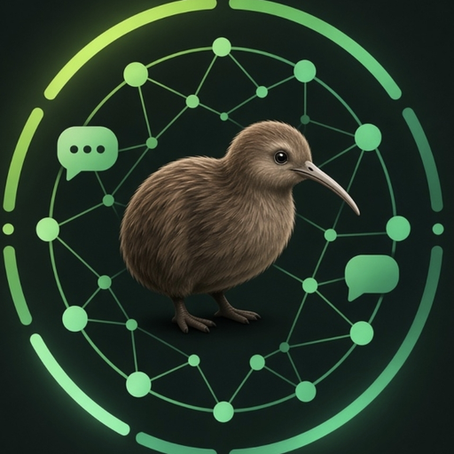

<p align="center"></p>

# Kiwion Chat 🥝

**Kiwion Chat** — самостоятельная ИИ-платформа от **Kiwi_Fuzzy**: собственный сервер инференса модели
**OLMo 2 1B Instruct** (исходные веса Ai2, Apache 2.0) на **llama.cpp**, сервер аккаунтов и API,
веб-интерфейс, Android-приложение, OpenAI-совместимый Developer API, CLI, админ-панель, реферальная
программа с антифродом — и секретная пушистая птичка киви.

Без Ollama и без сторонних платных API: генерация идёт только на вашем железе.

```
                     HTTPS (Caddy, Let's Encrypt)
 Браузер / Android / CLI / сторонние приложения
                │
        ┌───────▼────────────────────────┐   дешёвый VPS (512 МБ RAM достаточно)
        │ Kiwion Backend (FastAPI)        │   аккаунты, сессии, история, лимиты, рефералы,
        │  + Web, Admin, /docs, /launch   │   Developer API /v1, админ API, SQLite/PostgreSQL
        └───────┬────────────────────────┘
                │ WireGuard и/или mTLS  +  HMAC-подпись каждого запроса (защита от подмены и повтора)
        ┌───────▼────────────────────────┐   домашний ПК (Pentium 4417U, 8 ГБ RAM)
        │ Kiwion Inference (FastAPI)      │   очередь запросов, учёт токенов, шаблон OLMo 2
        │   └─ llama-server (llama.cpp)   │   GGUF Q4_K_M ≈ 0,9 ГБ, только 127.0.0.1
        └────────────────────────────────┘
```

## Структура

| Каталог | Что внутри |
|---|---|
| `backend/` | **Kiwion Backend** — FastAPI: авторизация, email, сессии/устройства, чаты со стримингом (SSE), лимиты, рефералы и антифрод, API-ключи, OpenAI-совместимый `/v1`, админ API |
| `inference/` | **Kiwion Inference** — отдельный сервис: запускает и supervises `llama-server`, FIFO-очередь с ограничением, HMAC/mTLS, учёт токенов |
| `web/` | **Kiwion Web** — SPA без сборщика (ES-модули): чат, Markdown + подсветка кода, настройки, ключи, рефералы, пасхалка; `launch.html` — обратный отсчёт; `docs.html` — документация API |
| `admin/` | **Kiwion Admin** — панель администратора (`/admin/`) |
| `mobile/` | **Kiwion Mobile** — Android-приложение (Java, только Android framework, без сторонних библиотек) |
| `cli/` | CLI `kiwion` (`chat`, `status`, `models`, `server start/stop`, `benchmark`) |
| `shared/` | общий код: шаблон чата OLMo 2, HMAC-подпись, редактирование логов, тексты |
| `assets/` | логотип, маскот (SVG), иконки |
| `scripts/` | сборка llama.cpp, загрузка/конвертация весов, сертификаты mTLS, dev-запуск, тестовая GGUF |
| `deploy/` | Dockerfile'ы, docker-compose (VPS и узел инференса), Caddyfile, systemd, пример WireGuard |
| `docs/` | архитектура, развёртывание, слабое железо, безопасность, тестирование |
| `tests/` | pytest: backend, inference (вкл. реальный llama.cpp и mTLS), CLI, e2e браузер (Playwright), мобильная логика |

## Быстрый старт (всё на одном компьютере)

```bash
cd kiwion-chat
python3 -m venv .venv && . .venv/bin/activate
pip install -e ".[backend,inference,dev]"

scripts/build_llamacpp.sh          # собирает llama.cpp под ваш процессор (5–15 мин)
scripts/download_model.sh          # исходные веса OLMo 2 1B Instruct -> GGUF Q4_K_M (~0,9 ГБ)

cp .env.example .env
sed -i "s/^KIWION_INFERENCE_SECRET=.*/KIWION_INFERENCE_SECRET=$(kiwion secret)/" .env
echo "KIWION_ADMIN_EMAILS=you@example.com" >> .env

kiwion server start --with-backend --wait 300
open http://127.0.0.1:8080          # регистрация; письма в режиме dev лежат в data/outbox/*.eml
kiwion chat                         # терминальный чат напрямую с моделью
kiwion status && kiwion benchmark
kiwion server stop
```

Без весов модели интерфейс можно посмотреть так: `scripts/dev.sh mock` (тестовый движок, в статусе
помечен как «тест»; в продакшене не используется).

## Компоненты подробнее

- **Чат:** несколько диалогов, история на сервере и синхронизация между устройствами, переименование и
  удаление, потоковая генерация, Markdown и подсветка кода, копирование ответа и блоков кода, повторная
  генерация, остановка, редактирование сообщений (история после него пересоздаётся), черновики не
  теряются (перезагрузка, нет сети, перегрузка), индикатор генерации и позиция в очереди, статус модели.
  При переполнении очереди — «Птичка киви немного устала 🥝. Сейчас слишком много запросов.
  Попробуйте отправить сообщение позже», а текст остаётся в поле ввода.
- **Аккаунты:** email + пароль (Argon2id), подтверждение email, восстановление пароля, сессии с
  управлением устройствами, профиль, смена пароля (выход на остальных устройствах), удаление аккаунта со
  всеми данными. Защита: proof-of-work при регистрации, лимиты по IP и устройству, запрет временных
  почт и псевдонимов (`a.b+x@gmail.com`), блокировка перебора паролей.
- **Рефералы:** уникальная ссылка `?ref=KIWI…`, бонусные токены и скидка (настраиваются в админке, с
  потолком), история начислений, награда только после подтверждения email, одноразовость начисления
  (уникальный индекс в БД). Антифрод — взвешенный риск: самоприглашения, циклы, общее устройство,
  много аккаунтов на устройстве, цепочки с одного устройства, скорость, временная почта, кластеры
  подсетей. **Совпадение IP — только слабый сигнал** и само по себе не отклоняет приглашение.
  Пограничные случаи уходят на ручную проверку в админке.
- **Developer API:** `/v1/models`, `/v1/chat/completions` (в т. ч. `stream: true` и
  `stream_options.include_usage`) — работает с официальными SDK `openai` для Python и JS. Ключи
  `kw-…` хранятся только как HMAC-хеш, показываются один раз, отзываются/удаляются, у каждого — лимит
  запросов в минуту и токенов в день, статистика по дням. Документация с примерами: `/docs`.
- **CLI:** см. `kiwion --help`. `kiwion chat --api-key kw-…` работает через публичный API.
- **Админка** (`/admin/`): **почта** (SMTP Gmail/Яндекс/Mail.ru с проверкой подключения, тестовым письмом, журналом писем и повторной отправкой кода; пароль хранится зашифрованным), пользователи (поиск, блокировка, лимиты, бонусы), статистика регистраций и
  токенов, активные диалоги, нагрузка модели и очередь, журнал ошибок (без паролей и токенов),
  рефералы на проверке, награды, **почта** (SMTP Gmail/Яндекс/Mail.ru с проверкой подключения, тестовым
письмом, журналом писем и повторной отправкой кода пользователю; пароль хранится зашифрованным), режим обслуживания, открытие/закрытие регистрации, чата и API, журнал
  действий администраторов. Доступ — только `role=admin` (проверяется на сервере).
- **Страница релиза:** `/launch` — логотип, анимированная киви, таймер до `KIWION_LAUNCH_AT`.
- **Android:** вход/регистрация (с proof-of-work), чат со стримингом и остановкой, история, настройки,
  API-ключи, рефералы, темы, «О приложении», анимации маскота, баннер «нет интернета», подсказки при
  медленной модели и очереди. Сборка: `mobile/build_apk.sh` (или Android Studio — `mobile/`).

## Секретная пасхалка 🥝

Настройки → О приложении → **Версия приложения** — 5 быстрых нажатий (пауза больше 1,5 с сбрасывает
счётчик). Экран затемняется, из-под нижнего края выпрыгивает пушистая киви, приземляется, моргает,
смотрит на вас, подпрыгивает и машет крылышками, появляется «You've found the Fluffy Kiwi! 🥝», киви
кружится среди зелёных частиц, затем — кнопка «Погладить киви» (глазки закрываются, звучит чирик,
сердечки, «Kiwi is happy!»). Закрывается крестиком, тапом по фону, «Назад»/Esc; работает многократно и
офлайн; при «уменьшении анимаций» в системе показывается упрощённая версия. Реализовано и в
Android-приложении (Canvas + аниматоры, звук синтезируется в коде), и в веб-версии.

## Документация

- [docs/ARCHITECTURE.md](docs/ARCHITECTURE.md) — архитектура и потоки данных
- [docs/DEPLOYMENT.md](docs/DEPLOYMENT.md) — VPS + домашний узел, HTTPS, WireGuard/mTLS, SMTP, бэкапы
- [docs/WEAK_HARDWARE.md](docs/WEAK_HARDWARE.md) — Pentium 4417U / 8 ГБ / Intel HD 620
- [docs/SECURITY.md](docs/SECURITY.md) — модель безопасности
- [docs/TESTING.md](docs/TESTING.md) — тесты и что было проверено
- [mobile/README.md](mobile/README.md) — сборка Android-приложения

## Лицензии

Код Kiwion Chat — Apache-2.0. Модель OLMo 2 — Apache-2.0 (Allen Institute for AI). llama.cpp — MIT.
Сторонние браузерные библиотеки — см. `web/vendor/LICENSES.md`.
